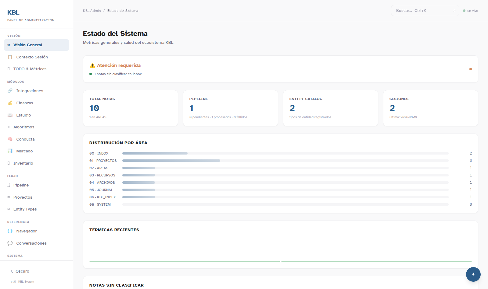
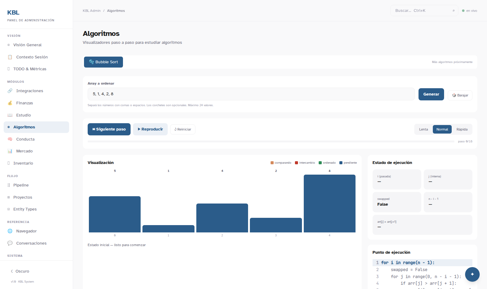
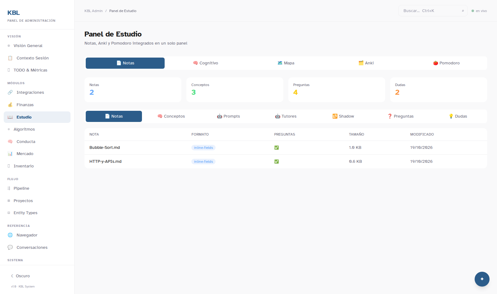

# KBL Admin

Full-stack study & productivity dashboard — a personal operating system that
turns raw study notes into tracked mastery, spaced repetition, cognitive-debt
metrics, and step-by-step algorithm visualizations.

**Stack:** React 18 + Vite + TypeScript + Tailwind · Express 4 + sql.js · Clean
Architecture with `shared_kernel/domain`, injected use-cases, and per-tower DI
wiring.



## Quick path

```bash
npm install
npm run dev        # API on http://127.0.0.1:3002 + UI on http://localhost:5174
```

A fresh clone boots standalone: JSON stores are born from bundled seed data and
dashboards read a bundled demo vault, so panels are populated with zero
configuration. To connect your own Obsidian vault, set
`KBL_VAULT_ROOT=/path/to/vault` in `.env` (see `.env.example`).

Run the test suite:

```bash
npm test           # Vitest unit + contract/acceptance/fase6 node --test suites
npm run build      # production build
```

## What's inside

| Area | What it does |
|------|--------------|
| **Estudio** | Parses Obsidian study notes (concepts, questions, doubts), Active Recall with SM-2 spaced repetition, Feynman-gated mastery scoring, cognitive-debt charts |
| **Algoritmos** | Step-by-step Bubble Sort visualizer with live debug panel (pointers, swaps, source-code line highlight) |
| **Overview / Projects** | Vault-wide health: note distribution, pipeline queue, session logs, entity catalog |
| **Todos & Context** | Task state machine (todo → done) parsed from `_PENDING.md`, backlog and roadmap parsing |
| **Finanzas** | Personal-finance SQLite domain with summaries, insights, comparison views |
| **Integrations** | Anki (AnkiConnect), NotebookLM proxy, Brave via CDP, WhatsApp feed |





## Architecture

Hexagonal/Clean Architecture on both sides of the stack. Routers never import
`lib/` or `fs/` directly — every dependency is injected by a single container
(`server/di-container.js`), and domain primitives live in
`shared_kernel/` (Entity, AggregateRoot, Result).

```
┌─ React SPA (Vite, TS) ────────────┐      ┌─ Express 4 ────────────────────────┐
│ components/  (dashboards, UI)     │ HTTP │ routes/ (thin routers)             │
│ stores/      (zustand)            │ ───► │   └─► use-cases/  (application)    │
│ api/         (typed fetch)        │      │         └─► lib/ + infrastructure/ │
│                                   │      │              (vault adapter,       │
│ shared_kernel/domain ◄────────────┼──────┼─── stores, sql.js, ports)          │
└───────────────────────────────────┘      └────────────────────────────────────┘
```

- **Persistence** is project-local (`server/data/`, gitignored) with env
  overrides: `KBL_DATA_DIR`, `MASTERY_STORE_PATH`, `ACTIVE_RECALL_STORE_PATH`.
  On first boot both stores seed from `server/seed/*.json` (synthetic demo data).
- **Vault integration** is optional and configurable: `KBL_VAULT_ROOT` points at
  a real Obsidian vault; when unset, `demo-vault/` ships a minimal tree (inbox,
  projects, study notes with inline fields, journal, queue, system logs) that
  every vault-dependent use-case can parse. Missing folders degrade gracefully
  (health warn, never crash).
- **Testing**: 61 Vitest unit/route tests + node --test suites (contract 21,
  fase5 33, fase6 26, active-recall 14, acceptance, observabilidad).

## Configuration reference

| Variable | Default | Purpose |
|----------|---------|---------|
| `PORT` | `3002` | API port |
| `HOST` | `127.0.0.1` | Bind address |
| `API_KEY` | *(empty = auth off)* | Require `x-api-key` on requests |
| `CORS_ORIGINS` | `*` | Comma-separated allowed origins |
| `KBL_VAULT_ROOT` | `./demo-vault` | Obsidian vault root to read |
| `KBL_DATA_DIR` | `server/data` | Directory for JSON stores |
| `MASTERY_STORE_PATH` | `$KBL_DATA_DIR/mastery-store.json` | Mastery store file |
| `ACTIVE_RECALL_STORE_PATH` | `$KBL_DATA_DIR/active-recall-store.json` | Active-recall store file |
| `MASTERY_SEED_PATH` / `ACTIVE_RECALL_SEED_PATH` | `server/seed/*.json` | First-boot seed files |
| `ANKI_URL` | `http://localhost:8765` | AnkiConnect endpoint |
| `CDP_URL` | `http://127.0.0.1:9222` | Chrome DevTools endpoint (Brave) |

## Project history

This repository started as the KBL_SYSTEM study workspace. The original
mid-2026 planning document for the gamification/mastery refactor — including
the redundant-concept audit and the NotebookLM feasibility study — is preserved
in [`docs/planning-2026-07-gamification-refactor.md`](docs/planning-2026-07-gamification-refactor.md).
Notable engineering fixes are logged in [`docs/DEVLOG.md`](docs/DEVLOG.md).

## Security

- `x-api-key` auth is fail-closed when the server binds outside loopback (no key ⇒ no boot).
- `KBL_DEMO=1` enables a read-only demo mode for public previews.
- Content-Security-Policy and rate limiting are on by default; fonts are self-hosted (no third-party origins).
- `npm run audit:prod` gates production dependency audits (`npm audit --omit=dev --audit-level=high`).

## License

[MIT](LICENSE)
